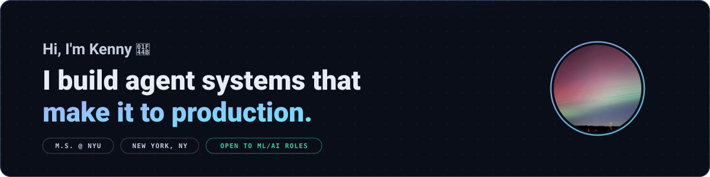
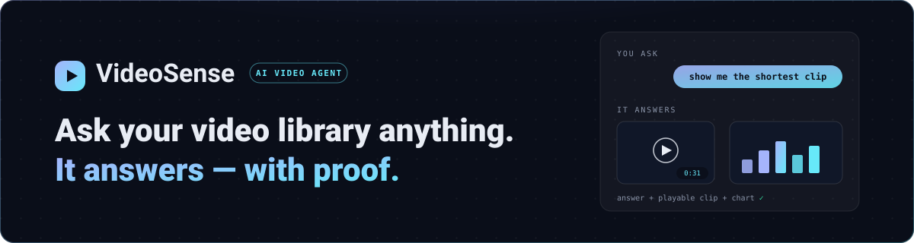
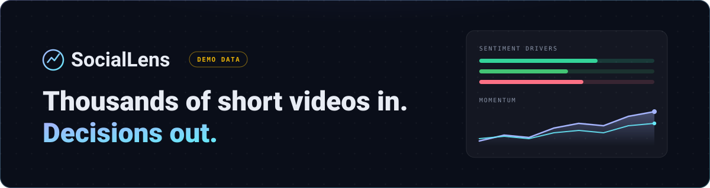

  

**[🌐 Portfolio](https://kenny0312.github.io)** &nbsp;·&nbsp; **[✉️ kennyqiu0312@gmail.com](mailto:kennyqiu0312@gmail.com)** &nbsp;·&nbsp; **[💼 LinkedIn](https://www.linkedin.com/in/kengyuan-qiu-niubi)**

 

## Things I've shipped

<table>
<tr>
<td width="50%" valign="top">
  
  <h3><a href="https://github.com/kenny0312/videosense-agent">VideoSense Agent</a></h3>
  
A conversational agent over your video library. It watches the footage, reasons in a tool-use loop, and answers with playable clips and charts — running in production with per-request cost telemetry and 146 tests.

  <b><a href="https://github.com/kenny0312/videosense-agent">Repo →</a></b>
</td>
<td width="50%" valign="top">
  
  <h3><a href="https://kenny0312.github.io/social-video-insights/">SocialLens</a></h3>
  
Short-form video in, decisions out. An interactive consumer-insights dashboard — sentiment drivers, momentum, personas, clip-level receipts — plus the real Gemini pipeline that generates it from raw footage.

  <b><a href="https://kenny0312.github.io/social-video-insights/">Live demo →</a></b> &nbsp;·&nbsp; <a href="https://github.com/kenny0312/social-video-insights">Repo →</a>
</td>
</tr>
</table>

 

**Also on the bench:** [DINOv2-GraphNAV](https://github.com/kenny0312/DINOv2-GraphNAV) — visual navigation from self-supervised feature graphs · [face_detect](https://github.com/kenny0312/face_detect) — real-time face recognition in video streams

 

M.S. student at New York University · I like owning the whole problem — model, data, API, tests, deploy.

